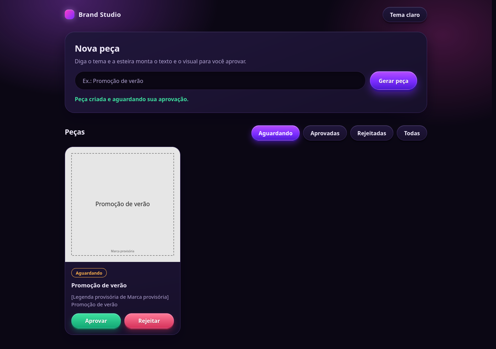
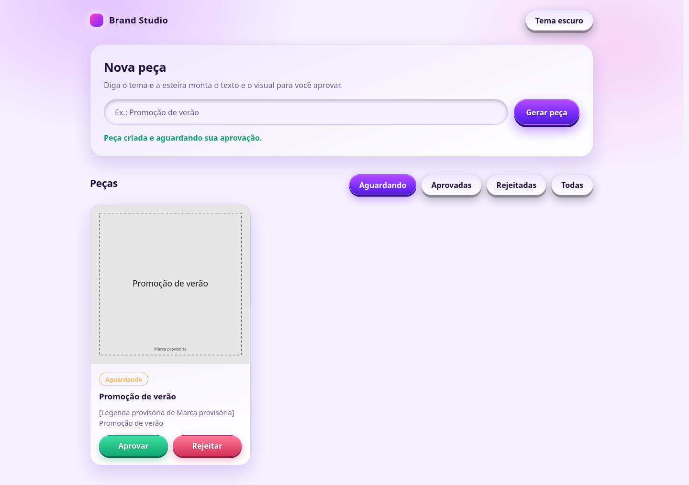
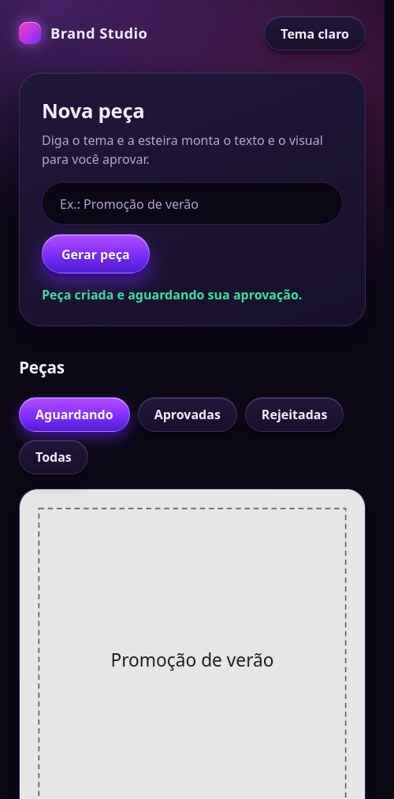

# Brand Studio

Uma esteira de produção de conteúdo de marca: você informa um tema, recebe uma peça com título, legenda e visual e decide se ela deve ser aprovada ou rejeitada.

O objetivo é evoluir para a criação de posts, carrosséis e vídeos curtos com identidade visual consistente, variedade de estilos e acabamento profissional, mantendo a revisão humana antes de qualquer publicação.

**Estado atual: protótipo funcional, versão 0.1.0.** O fluxo de geração, armazenamento e aprovação já funciona pelo navegador e pelo terminal. O conteúdo ainda é provisório: a aplicação usa uma marca fixa, repete o tema como título e desenha um SVG simples. Não há chamadas a IA, geração de vídeos ou publicação em redes sociais nesta versão.

## Índice

- [O que já funciona](#o-que-já-funciona)
- [Interface e prints](#interface-e-prints)
- [Como rodar após clonar](#como-rodar-após-clonar)
- [Usar pelo terminal](#usar-pelo-terminal)
- [Arquivos gerados e aprovação](#arquivos-gerados-e-aprovação)
- [Como a esteira funciona](#como-a-esteira-funciona)
- [API local](#api-local)
- [Tecnologias e estrutura](#tecnologias-e-estrutura)
- [Testes e conferências](#testes-e-conferências)
- [O que ainda será desenvolvido](#o-que-ainda-será-desenvolvido)
- [Limitações atuais](#limitações-atuais)
- [Problemas comuns](#problemas-comuns)
- [Decisões e desenvolvimento](#decisões-e-desenvolvimento)

## O que já funciona

### Produção e organização

- Receber um tema e recusar pedidos vazios.
- Executar a sequência de marca, roteiro, visual, conferência e gravação.
- Criar um título a partir do tema e uma legenda provisória.
- Gerar um arquivo vetorial SVG de 1080 × 1080, com fundo cinza, borda, título e nome da marca provisória.
- Escapar caracteres especiais do tema para não quebrar o SVG.
- Conferir título, legenda e conteúdo visual vazios. Os avisos são informativos; a decisão final é humana.
- Salvar cada peça em uma pasta própria, com registro JSON, legenda em TXT e visual SVG.
- Usar data, hora e tema no identificador; adicionar sufixos quando houver pedidos iguais no mesmo segundo, evitando sobrescrita.
- Listar as peças da mais recente para a mais antiga e persistir seu status em disco.

### Painel web

- Gerar peças por um formulário.
- Exibir cartões com prévia do visual, título, legenda, status e eventuais avisos.
- Filtrar por **Aguardando**, **Aprovadas**, **Rejeitadas** ou **Todas**.
- Aprovar ou rejeitar peças pendentes.
- Mostrar mensagens de andamento, sucesso e erro; desabilitar o botão de geração enquanto o pedido está em execução.
- Alternar entre tema escuro e claro, lembrando a preferência no navegador.
- Usar uma interface roxa com gradientes, botões em relevo e iluminação que acompanha o cursor.
- Adaptar a disposição dos cartões à largura disponível, oferecer foco visível por teclado e respeitar a preferência de redução de movimento nas transições. A experiência em celular ainda precisa de validação visual.

### Terminal e execução local

- Gerar peças, listar pendentes e aprovar ou rejeitar por comandos.
- Compartilhar o mesmo núcleo entre terminal e painel: uma peça criada em um aparece no outro após atualizar a lista.
- Rodar sem banco de dados, etapa de compilação ou configuração de serviços externos.
- Servir a interface e uma API HTTP local com o servidor nativo do Node.
- Escutar apenas em `127.0.0.1`, restringindo o painel ao próprio computador.

## Interface e prints

O painel tem um formulário **Nova peça** no topo e uma grade **Peças** com filtros e ações de aprovação abaixo. O tema escuro é o padrão; o botão no cabeçalho alterna para o claro.

Capturas reais feitas em 28/10/2026, com uma peça gerada pelo formulário e aguardando aprovação. A arte cinza é o resultado provisório real do gerador.

### Tema escuro



### Tema claro



### Janela estreita

Captura com largura de 500 px no Firefox, mostrando a reorganização do formulário e dos filtros. Não equivale a um teste em celular físico ou em larguras menores.



O [guia de capturas](docs/prints/README.md) explica como atualizar as imagens e resolver bloqueios de permissão.

## Como rodar após clonar

### 1. Pré-requisitos

- **Git**, para clonar o repositório.
- **Node.js 22.18 ou superior**, com suporte à execução de TypeScript, e **npm**.
- Um navegador para usar o painel.
- Acesso à internet para baixar o repositório e as dependências na instalação.

Esta versão não exige chave de API, arquivo `.env`, conta em provedor de IA, banco de dados ou placa de vídeo dedicada. Após a instalação, a geração provisória funciona localmente, sem acessar serviços de IA.

Confira as ferramentas no terminal:

```bash
git --version
node --version
npm --version
```

### 2. Clonar e instalar

```bash
git clone https://github.com/EduBeloDev/brand-studio.git
cd brand-studio
npm ci
```

`npm ci` instala as dependências conforme o `package-lock.json`. Não use `--omit=dev`: os comandos dependem de ferramentas que estão em `devDependencies`, incluindo o Node oficial instalado pelo projeto. Para atualizar dependências durante o desenvolvimento, use `npm install` e revise as mudanças no arquivo de versões.

### 3. Iniciar o painel

```bash
npm run painel
```

Abra **http://localhost:3000** no navegador. O comando mantém o servidor ativo no terminal; ele não abre o navegador automaticamente. Para encerrar, pressione `Ctrl+C`.

Não é necessário executar um comando de build. O Node executa os arquivos TypeScript diretamente, removendo os tipos durante a execução. Os comandos `npm run` usam o Node instalado no projeto, evitando depender de uma instalação do sistema que não tenha esse suporte.

### 4. Gerar e revisar a primeira peça

1. No campo **Nova peça**, escreva um tema curto, como `Promoção de verão`.
2. Clique em **Gerar peça**.
3. A peça aparece no filtro **Aguardando**, com o visual provisório e a legenda.
4. Confira o conteúdo e clique em **Aprovar** ou **Rejeitar**.
5. Abra o filtro correspondente para encontrar a peça depois da decisão.

Um clone novo começa sem peças: `saida/` não é versionada e será criada automaticamente na primeira geração. Recarregue a página para ver alterações feitas por outro terminal ou outra aba.

**Aprovar muda apenas o status local. Não publica a peça.**

### Usar outra porta

A única variável de ambiente lida atualmente é `PORT`, com padrão `3000`. Defina-a no terminal antes de iniciar:

```bash
# Linux/macOS
PORT=3001 npm run painel
```

```powershell
# Windows PowerShell
$env:PORT = "3001"
npm run painel
```

Nesse exemplo, abra http://localhost:3001. O servidor continua restrito ao próprio computador. O projeto não carrega arquivos `.env` automaticamente.

## Usar pelo terminal

Execute os comandos na raiz do projeto. O servidor web não precisa estar ligado para usar o terminal.

| Comando | Função |
| --- | --- |
| `npm run painel` | Inicia o painel e a API local |
| `npm run gerar -- "Promoção de verão"` | Gera e salva uma peça pendente |
| `npm run revisar` | Lista somente as peças aguardando aprovação, com seus IDs e contagem de avisos |
| `npm run revisar -- ID_DA_PECA aprovar` | Marca a peça como aprovada |
| `npm run revisar -- ID_DA_PECA rejeitar` | Marca a peça como rejeitada |
| `npm test` | Executa os testes automatizados |
| `npm run tipos` | Confere os tipos TypeScript, sem gerar arquivos |

Substitua `ID_DA_PECA` pelo identificador informado ao gerar ou listar. Por exemplo, se o comando retornar `2026-10-28-153000-promocao-de-verao`:

```bash
npm run revisar -- 2026-10-28-153000-promocao-de-verao aprovar
```

O identificador acima é ilustrativo; use o da sua execução. A CLI permite mudar uma decisão anterior passando novamente `aprovar` ou `rejeitar`. O painel exibe esses botões apenas nas peças pendentes.

## Arquivos gerados e aprovação

```text
saida/
└── 2026-10-28-153000-promocao-de-verao/
    ├── peca.json
    ├── legenda.txt
    └── visual.svg
```

| Arquivo | Conteúdo |
| --- | --- |
| `peca.json` | ID, data de criação, status, pedido original, roteiro, nome do visual e avisos |
| `legenda.txt` | Legenda em texto simples para consultar ou copiar |
| `visual.svg` | Arte vetorial provisória, que pode ser aberta no navegador |

As peças começam em `aguardando-aprovacao` e podem mudar para `aprovada` ou `rejeitada`. A decisão fica no `peca.json`; não move nem apaga os arquivos. A API também aceita devolver uma peça para `aguardando-aprovacao`, embora não exista botão para isso na interface.

A pasta usa data e hora locais no nome; a data do registro JSON é salva no formato ISO. Pastas sem registro são ignoradas na listagem; um JSON corrompido gera erro.

`saida/` fica fora do Git. Para preservar seu histórico, faça uma cópia dessa pasta. Não há banco de dados nem sincronização com nuvem.

## Como a esteira funciona

```text
Tema → Kit da marca → Roteiro → Visual → Conferência → Arquivos → Aprovação humana
```

| Etapa | Comportamento atual | Evolução desejada |
| --- | --- | --- |
| Pedido | Recebe e valida um tema | Definir formato e demais informações do pedido |
| Marca | Retorna nome, cinzas e fonte genérica fixos | Carregar identidade, logo, cores, fontes e tom de voz reais |
| Roteiro | Usa o tema como título e uma legenda provisória | Produzir conteúdo adequado à marca e ao formato com IA |
| Visual | Desenha um SVG quadrado simples | Compor peças elaboradas, imagens, carrosséis e vídeos |
| Conferência | Detecta título, legenda e arquivo visual vazios | Conferir identidade visual e qualidade do resultado |
| Saída | Salva arquivos locais e status | Rever armazenamento e formatos conforme a evolução |
| Aprovação | Permite decisão humana pela CLI, painel e API | Preservar a revisão antes de qualquer publicação futura |

As estações foram separadas para permitir substituir as versões provisórias aos poucos. O arquivo `core/linha.ts` coordena a sequência; a interface web e os comandos chamam esse mesmo núcleo.

## API local

Disponível enquanto `npm run painel` estiver ativo. Não existe autenticação nesta versão; o servidor é destinado ao uso local.

| Método | Rota | Resultado |
| --- | --- | --- |
| `GET` | `/api/pecas` | Lista todas as peças, das mais novas para as mais antigas |
| `POST` | `/api/pecas` | Cria uma peça com o corpo `{"tema":"Promoção de verão"}`; retorna HTTP 201 |
| `POST` | `/api/pecas/:id/status` | Atualiza o status com `{"status":"aprovada"}` ou outro status válido |
| `GET` | `/pecas/:id/:arquivo` | Serve um arquivo da peça, como `visual.svg`, `legenda.txt` ou `peca.json` |

Os pedidos `POST` exigem `Content-Type: application/json`; o corpo tem limite de 10.000 bytes. Os status válidos são `aguardando-aprovacao`, `aprovada` e `rejeitada`. Erros tratados pela API retornam HTTP 400 com um campo `erro`.

Exemplo em um segundo terminal, com o servidor ativo (requer `curl`):

```bash
curl http://localhost:3000/api/pecas

curl -X POST http://localhost:3000/api/pecas \
  -H 'Content-Type: application/json' \
  -d '{"tema":"Promoção de verão"}'
```

Há validação de identificadores e contenção dos caminhos de arquivos, escape XML no SVG, uso de `textContent` na interface e bloqueio de scripts nos SVGs servidos. Essas medidas não substituem autenticação e revisão de segurança caso a aplicação passe a ser hospedada na internet.

## Tecnologias e estrutura

- **TypeScript + Node.js:** núcleo, CLI e servidor HTTP nativo.
- **HTML, CSS e JavaScript puro:** interface sem framework nem compilação.
- **Sistema de arquivos + JSON:** persistência local.
- **SVG:** visual provisório.
- **Vitest:** testes automatizados.
- **TypeScript (`tsc`):** conferência estática de tipos.
- **npm + package-lock.json:** comandos e dependências.

```text
brand-studio/
├── README.md                 Guia de instalação, uso e estado do produto
├── CLAUDE.md                 Decisões, diretrizes e continuidade do trabalho
├── core/
│   ├── tipos.ts              Contratos entre as etapas
│   ├── linha.ts              Coordenação da produção
│   ├── saida.ts              Gravação, leitura e alteração de status
│   ├── linha.test.ts         Testes do núcleo
│   └── estacoes/
│       ├── marca.ts          Kit de marca provisório
│       ├── roteiro.ts        Título e legenda provisórios
│       ├── visual.ts         Construção do SVG
│       └── revisao.ts        Conferências básicas
├── cli/
│   └── index.ts              Comandos gerar e revisar
├── web/
│   ├── server.ts             API e arquivos estáticos em 127.0.0.1
│   └── public/
│       ├── index.html        Estrutura do painel
│       ├── estilo.css        Aparência e temas
│       └── app.js            Interações e comunicação com a API
├── docs/prints/              Capturas reais e orientações para atualizá-las
├── saida/                    Peças locais; criada ao gerar, fora do Git
├── package.json              Dependências e comandos
├── package-lock.json         Versões das dependências
├── tsconfig.json             Regras do TypeScript, sem emissão de build
└── .gitignore                Exclui dependências, saídas, .env e amostras locais
```

Arquivos locais de referência de personagem não constituem um gerador de personagens ou recurso integrado ao painel. A pasta `amostras/` está ignorada pelo Git e não deve ser necessária para executar um clone novo.

## Testes e conferências

```bash
npm test
npm run tipos
```

Conferido em 28/10/2026: **8 testes passando** e checagem de tipos sem erros. Os testes cobrem geração com arquivos, recusa de tema vazio, colisão de identificadores, escape do SVG, persistência de aprovação, lista vazia, bloqueio de ID com caminho e erro de peça inexistente. Usam pastas temporárias, sem alterar `saida/`.

Não há uma suíte de testes automatizados de navegador no repositório. A checagem de tipos inclui o núcleo, a CLI e o servidor; não verifica o JavaScript da interface. Após atualizar as permissões do ambiente, foram conferidos o acesso à API, a geração pelo formulário e a alternância de temas no Firefox, com inspeção das capturas em janela ampla e estreita (500 px). Ainda falta validar em celular e em larguras menores.

## O que ainda será desenvolvido

Os itens abaixo registram a direção desejada. Não são funcionalidades disponíveis nem um compromisso de prazo; algumas escolhas ainda precisam ser fechadas.

### Conteúdo e identidade

- Kit de marca real com logo, paleta, fontes, tom de voz e restrições.
- Roteiros e legendas produzidos por IA seguindo esse kit.
- Templates com hierarquia visual, quebra de linha, composição e tipografia adequadas.
- Conferências de identidade e qualidade além da presença de conteúdo.

### Imagens e carrosséis

- Integração com geração de imagens e opções de estilos coerentes: editorial, fotografia, colagem, produto e aparência 3D, por exemplo.
- Carrosséis com capa, explicação, comparação, exemplos e fechamento, variando a composição de acordo com a função de cada slide.
- Texto composto separadamente das imagens para controlar fonte, acentos, contraste e nitidez.
- Exportação em dimensões adequadas ao destino, com imagens de origem suficientes, margens e leitura no celular.

### Vídeos e personagens

- Vídeos curtos com roteiro por cenas, enquadramentos, ações e transições planejados.
- Edição com ritmo, pausas, legendas, som e efeitos ligados ao conteúdo.
- Mistura de fotografias, gravações de tela, produto, ilustrações e cenas geradas quando fizer sentido.
- Personagens com aparência 3D ou modelagem 3D real, preservando rosto, roupas, materiais e proporções entre cenas.
- Avaliação de ferramentas: Blender para 3D real e Remotion para montagem por código são possibilidades, ainda não adotadas ou instaladas.

### Qualidade visual e prevenção de “AI slop”

- Definir direção de arte e referências antes de gerar, mantendo coerência dentro de cada peça.
- Evitar imagens sem relação com a mensagem, textos genéricos, efeitos decorativos repetidos e movimento constante sem intenção.
- Revisar artefatos, anatomia, iluminação, continuidade dos personagens e legibilidade.
- Produzir e aprovar uma peça piloto antes de multiplicar um estilo em escala. A sugestão atual é um vídeo curto e um carrossel do mesmo tema.
- Usar referências de linguagem de TikTok e Instagram como orientação criativa, sem promessa de viralização.

### Decisões de operação ainda abertas

- Formatos prioritários, dimensões de exportação e origem do kit de marca.
- Provedores e modelos de IA, orçamento e limites de gasto por execução.
- Armazenamento definitivo e necessidade de infraestrutura externa.
- Produção sob pedido ou agendada e eventual integração de publicação nas redes.
- Autenticação e hospedagem, se o painel deixar de ser exclusivamente local.
- Licenças comerciais de fontes, imagens, modelos, músicas e demais materiais.

As decisões detalhadas ficam em [CLAUDE.md](CLAUDE.md).

## Limitações atuais

- O pedido aceita apenas um tema: não há seleção de formato, duração, estilo ou marca.
- Marca e legenda são provisórias; nenhuma API de IA é utilizada.
- O visual é um SVG cinza quadrado, sem fotografia, imagens geradas, PNG, vídeo ou carrossel.
- Títulos longos podem ultrapassar a borda do SVG; o template ainda não trata quebra de linha.
- Não há editor de conteúdo, upload de referências, biblioteca de fontes, geração em lote ou botão de download. Os arquivos podem ser acessados em `saida/` e pelas rotas locais.
- O painel não oferece desfazer aprovação/rejeição, exclusão, busca ou atualização em tempo real. A CLI pode mudar decisões e a API também pode retornar ao status pendente.
- Aprovação não publica nem agenda conteúdo, e não há integração com Instagram ou TikTok.
- Não há histórico de versões ou auditoria das mudanças de status; o registro guarda o estado atual.
- Não há contas de usuário, banco de dados, backup automático ou sincronização.
- Não há carregamento automático de `.env`, nem necessidade de configurá-lo para usar o protótipo.
- O painel não é acessível por outro computador ou celular da rede, pois escuta apenas no endereço local.

## Problemas comuns

| Sintoma | Como resolver |
| --- | --- |
| `git`, `node` ou `npm` não encontrado | Instale o pré-requisito e reabra o terminal |
| Erro relacionado a TypeScript ao usar `node arquivo.ts` | Execute os comandos `npm run` após instalar todas as dependências; eles usam o Node oficial do projeto |
| Dependência ou comando não encontrado | Confirme que está na raiz e rode `npm ci`, sem omitir dependências de desenvolvimento |
| Porta 3000 em uso (`EADDRINUSE`) | Encerre a outra instância ou configure `PORT` |
| Permissão negada para abrir a porta (`EPERM`) | Execute em um terminal local que permita servidor ou atualize as permissões da sessão do agente. Depois repita o comando; veja o [guia de diagnóstico](docs/prints/README.md#se-o-bloqueio-de-permissão-voltar) |
| Navegador não abre o painel | Confira o endereço e a porta e mantenha `npm run painel` executando |
| A lista parece vazia | Confira o filtro; peças aprovadas ou rejeitadas saem de **Aguardando**. Em clone novo, gere a primeira peça |
| Peça criada na CLI não apareceu na aba aberta | Recarregue a página; não existe atualização em tempo real |
| A peça não foi publicada após aprovar | Esse é o comportamento atual: aprovação só salva o status local |
| Arquivo `peca.json` corrompido | Recupere o registro de uma cópia válida; o sistema informa o arquivo com problema e não o corrige automaticamente |

## Decisões e desenvolvimento

Consulte [CLAUDE.md](CLAUDE.md) antes de alterar a arquitetura ou construir novas etapas. Ele reúne as decisões, os riscos, as diretrizes de qualidade visual e o ponto de continuidade do projeto.

Mantenha regras compartilhadas em `core/`, comandos em `cli/` e interações HTTP/interface em `web/`. Ao substituir uma estação provisória, preserve o fluxo de revisão e atualize a documentação para distinguir o que está implementado do que continua planejado.


## Regra de desenvolvimento: testes primeiro

**Sempre escrever e executar testes antes de implementar ou alterar um caso de uso.** Definir critérios de aceitação, verificar que o teste falha pelo comportamento ausente, implementar, confirmar que passa e só então refatorar. Cobrir o fluxo principal e erros relevantes. Um bloqueio de execução deve ser registrado; não conta como validação concluída. A regra completa está no [CLAUDE.md](CLAUDE.md).


## Licença e autoria

Copyright © 2026 Eduardo Simonelli (EduBeloDev). O código e a documentação originais estão sob a [licença própria do Brand Studio](LICENSE), de código disponível com restrição de comercialização do software. **Não é MIT nem uma licença open source aprovada pela OSI.**

| Uso | Condição |
| --- | --- |
| Clonar, estudar, executar e modificar | Permitido |
| Redistribuir gratuitamente o código ou versões modificadas | Permitido, preservando licença e autoria e identificando alterações |
| Produzir conteúdo monetizado para Instagram, TikTok e outras plataformas | Permitido |
| Vender vídeos, imagens e serviços de produção usando o programa internamente | Permitido |
| Vender o software, versões modificadas ou acesso pago/SaaS às suas funções | Exige autorização prévia por escrito do titular |

O titular mantém seus direitos e pode explorar comercialmente o próprio software. A licença não exige créditos do programa nos conteúdos gerados. Materiais e dependências de terceiros mantêm suas próprias licenças. O texto completo do `LICENSE` estabelece as condições; esta seção é um resumo.
