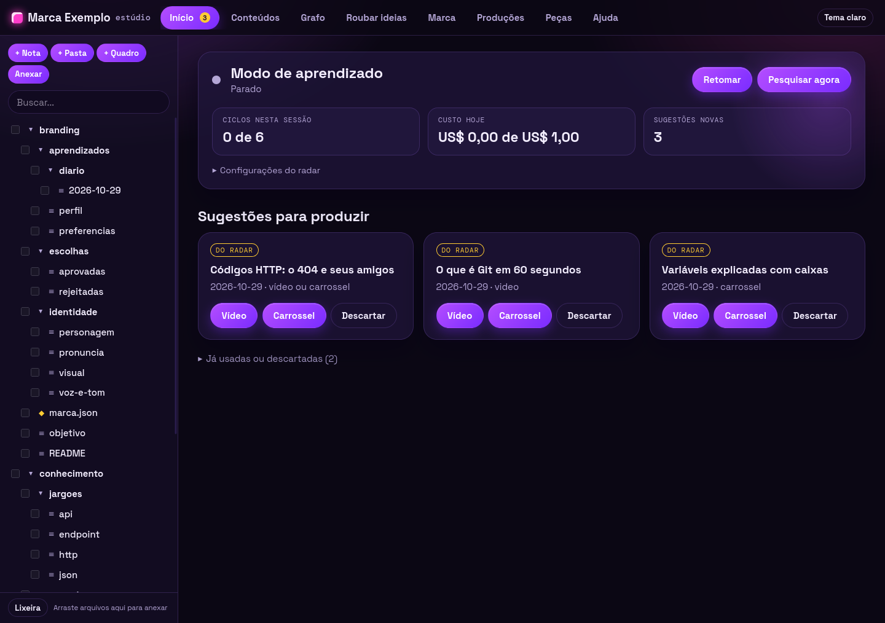
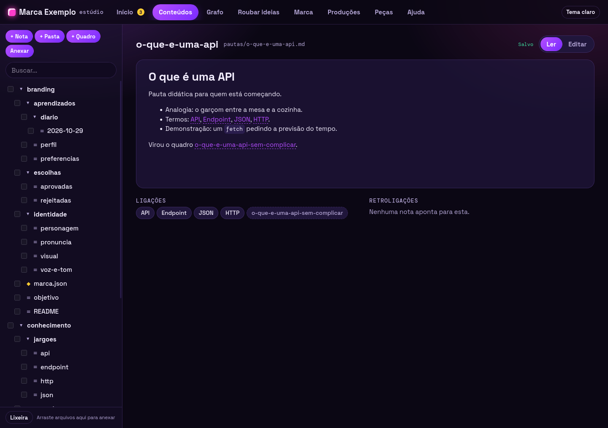
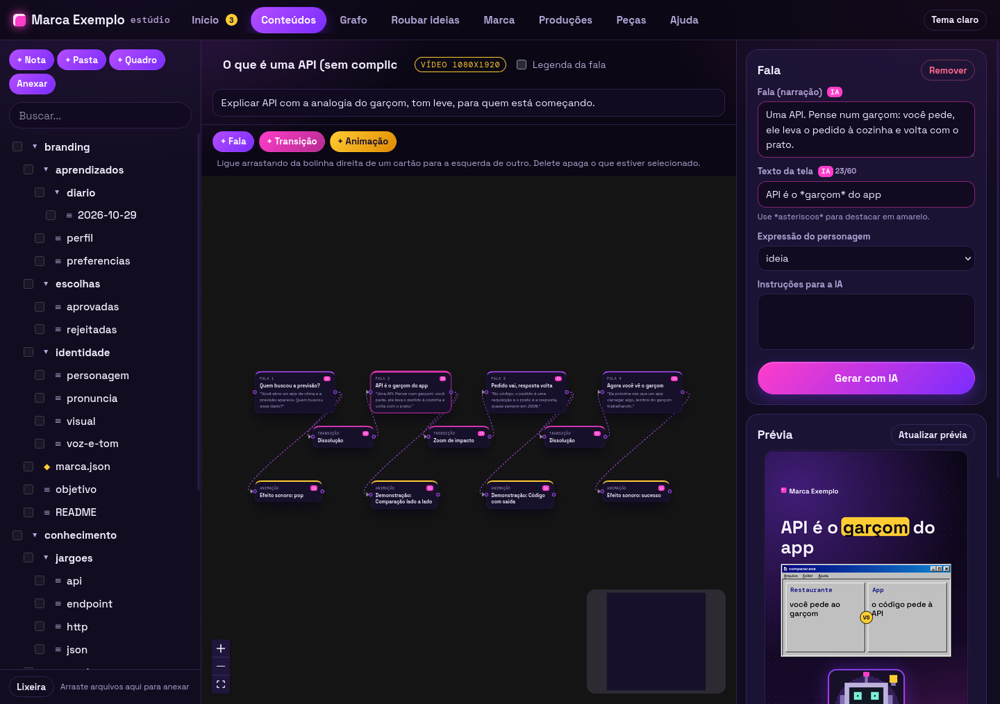
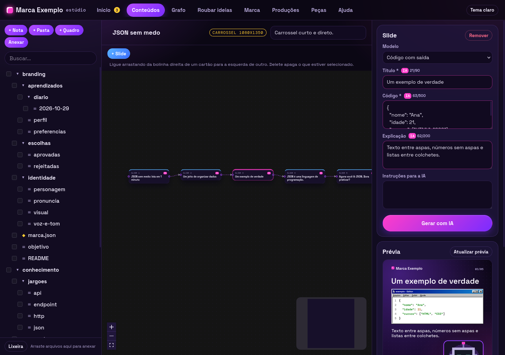
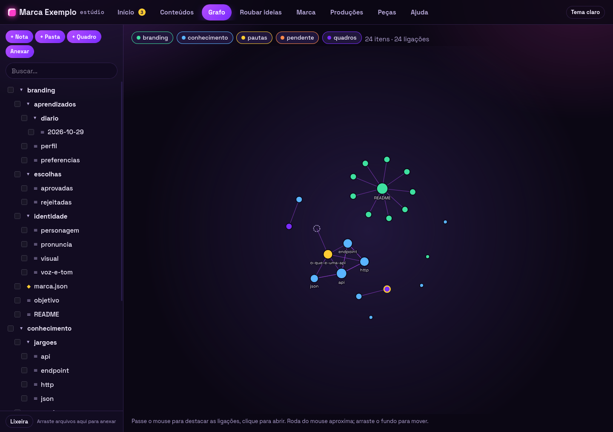
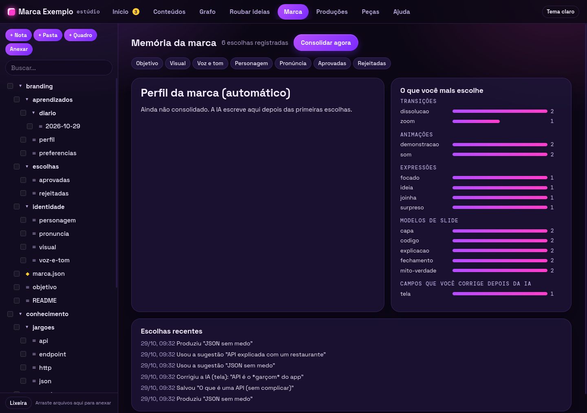
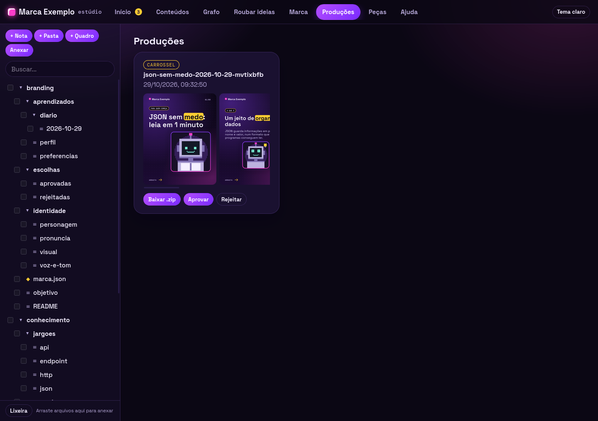
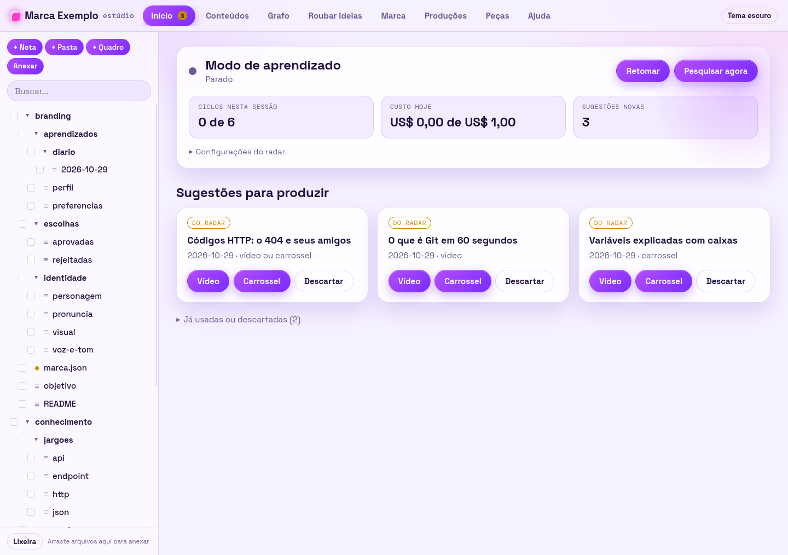
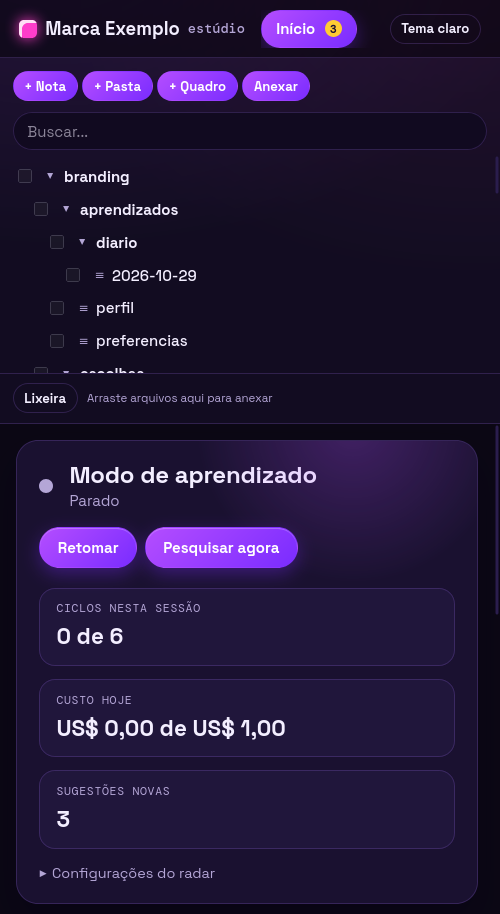

# Brand Studio

Uma esteira de produção de conteúdo de marca: você informa um tema, recebe uma peça com título, legenda e visual e decide se ela deve ser aprovada ou rejeitada.

O objetivo é evoluir para a criação de posts, carrosséis e vídeos curtos com identidade visual consistente, variedade de estilos e acabamento profissional, mantendo a revisão humana antes de qualquer publicação.

**Estado atual (29/10/2026): versão 0.1.0, em desenvolvimento.** Há duas partes:

- **Estúdio de conteúdo** (novo, aberto em `npm run app`): notas e pastas em `conteudo/`, grafo de ligações, quadros de vídeo e de carrossel, IA dentro do app (Claude Code em modo restrito), memória de branding, modo de aprendizado que pesquisa tendências sozinho, análise de referências ("roubar ideias") e renderização de vídeos 1080x1920 e carrosséis 1080x1350 pelo motor em Python de `amostras/`.
- **Esteira de peças** (original, aba **Peças** e terminal): gera, lista e aprova peças. As estações dela continuam provisórias (marca fixa, título igual ao tema, SVG simples).

Nada é publicado em redes sociais: tudo o que sai fica em `saida/` para a pessoa revisar.

## Índice

- [Estúdio de conteúdo](#estúdio-de-conteúdo)
- [O que já funciona](#o-que-já-funciona)
- [Telas](#telas)
- [Como rodar após clonar](#como-rodar-após-clonar)
- [Usar pelo terminal](#usar-pelo-terminal)
- [Arquivos gerados e aprovação](#arquivos-gerados-e-aprovação)
- [Como a esteira funciona](#como-a-esteira-funciona)
- [API local](#api-local)
- [Tecnologias e estrutura](#tecnologias-e-estrutura)
- [Testes e conferências](#testes-e-conferências)
- [O que ainda será desenvolvido](#o-que-ainda-será-desenvolvido)
- [Correções pendentes](#correções-pendentes)
- [Sua marca fica no seu computador](#sua-marca-fica-no-seu-computador)
- [Limitações atuais](#limitações-atuais)
- [Problemas comuns](#problemas-comuns)
- [Decisões e desenvolvimento](#decisões-e-desenvolvimento)

## Estúdio de conteúdo

Detalhes, decisões e andamento em [docs/estudio.md](docs/estudio.md); problemas encontrados e soluções em [docs/problemas.md](docs/problemas.md). A aba **Ajuda** do app tem um passo a passo de cada fluxo.

| Aba | O que faz |
| --- | --- |
| Início | Mostra o modo de aprendizado (radar): ciclos, custo do dia, descobertas e sugestões de vídeo/carrossel. Uma sugestão vira quadro com um clique. |
| Conteúdos | Barra lateral com as pastas de `conteudo/`; criar, renomear (atualiza as ligações `[[nome]]`), mover, excluir para a lixeira e restaurar; editor de notas; quadros com prévia ao lado. |
| Grafo | As notas e suas ligações, como no Obsidian. |
| Roubar ideias | Recebe vídeo, áudio ou imagem de referência, extrai ritmo, quadros, transcrição e cores localmente e pede à IA técnicas reaproveitáveis, sem copiar o texto. |
| Marca | Identidade escrita pela pessoa, preferências calculadas das escolhas e perfil consolidado pela IA (`conteudo/branding/`). |
| Produções | Vídeos e carrosséis renderizados, com as tarefas em andamento. |
| Peças | A esteira original. |
| Ajuda | Busca, perguntas frequentes e passo a passo. |

**Quadro de vídeo:** cartões de fala formam a linha principal; transições e animações (demonstração de código, comparação, lista, bombinha, sons) ficam presas à fala em que acontecem. **Quadro de carrossel:** cartões de slide em ordem, cada um com um modelo (capa, explicação, comparação, código, mito ou verdade, passos, fechamento). Os quadros são arquivos `.quadro.json` em `conteudo/quadros/` e salvam sozinhos.

**Produzir** coloca a renderização numa fila em segundo plano. O vídeo é narrado (Chatterbox com timbre da Piper), alinhado pelo Whisper, mixado com trilha chiptune e efeitos sintetizados. O carrossel sai como um PNG por slide e um `.zip`. Tudo vai para `saida/estudio/`.

**Pronúncia:** `conteudo/branding/identidade/pronuncia.md` diz como falar siglas e jargões; o app aplica só na voz, a tela e a legenda usam a grafia normal.

**Custo:** a IA roda pelo comando `claude` já autenticado na máquina. O radar tem teto de custo por dia e de ciclos por sessão (configuráveis) e anota o custo de cada ciclo. Para abrir o app sem o radar começar sozinho: `RADAR=desligado npm run app`.

## O que já funciona

### Produção e organização

- Receber um tema e recusar pedidos vazios.
- Executar a sequência de marca, roteiro, visual, conferência e gravação.
- Criar um título a partir do tema e uma legenda provisória.
- Gerar um arquivo vetorial SVG de 1080 × 1080, com fundo cinza, borda, título e nome da marca provisória.
- Escapar caracteres especiais do tema para não quebrar o SVG.
- Conferir título, legenda e conteúdo visual vazios. Os avisos são informativos; a decisão final é humana.
- Salvar cada peça em uma pasta própria, com registro JSON, legenda em TXT e visual SVG.
- Usar data, hora e tema no identificador; adicionar sufixos quando houver pedidos iguais no mesmo segundo, evitando sobrescrita.
- Listar as peças da mais recente para a mais antiga e persistir seu status em disco.

### Aba Peças (esteira original)

- Gerar uma peça a partir de um tema.
- Listar as peças com prévia do visual, título, legenda, status e avisos.
- Aprovar ou rejeitar peças pendentes.
- O tema escuro ou claro, a navegação por teclado e a disposição na tela seguem o resto do app.

### Terminal e execução local

- Gerar peças, listar pendentes e aprovar ou rejeitar por comandos.
- Compartilhar o mesmo núcleo entre terminal e painel: uma peça criada em um aparece no outro após atualizar a lista.
- Rodar sem banco de dados nem serviços externos; só a interface do estúdio tem build (Vite).
- Servir a interface e uma API HTTP local com o servidor nativo do Node.
- Escutar apenas em `127.0.0.1`, restringindo o painel ao próprio computador.

## Telas

Capturas de 29/10/2026 feitas numa cópia de demonstração, com uma marca fictícia ("Marca Exemplo") e o robozinho de exemplo do motor. Nenhuma tela mostra conteúdo de uma marca real. Como refazer: [docs/prints/README.md](docs/prints/README.md).

### Início: modo de aprendizado e sugestões

O radar pesquisa tendências sozinho, dentro de um teto de custo, e transforma o que acha em sugestões. Cada sugestão vira um quadro de vídeo ou de carrossel com um clique.



### Conteúdos: notas com ligações

As notas são arquivos Markdown de verdade em `conteudo/`, com ligações `[[nome]]` e retroligações.



### Quadro de vídeo

As falas formam a linha principal; transições e animações ficam presas à fala. Ao clicar num cartão, a prévia da cena é desenhada pelo motor em segundos.



### Quadro de carrossel

Slides em ordem, cada um com um modelo (capa, explicação, código, mito ou verdade, fechamento) e prévia em 1080x1350.



### Grafo



### Marca: memória de branding

O app registra escolhas, aprovações e correções feitas depois da IA, calcula preferências e consolida um perfil da marca.



### Produções



### Tema claro e janela estreita

 

A janela de 500 px não equivale a um teste em celular. Nela, as abas do topo rolam para o lado sem indicação visível (ver pendências).

## Como rodar após clonar

### 1. Pré-requisitos

- **Git**, para clonar o repositório.
- **Node.js 22.18 ou superior**, com suporte à execução de TypeScript, e **npm**.
- Um navegador para usar o painel.
- Acesso à internet para baixar o repositório e as dependências na instalação.

Esta versão não exige chave de API, arquivo `.env`, conta em provedor de IA, banco de dados ou placa de vídeo dedicada. Após a instalação, a geração provisória funciona localmente, sem acessar serviços de IA.

Confira as ferramentas no terminal:

```bash
git --version
node --version
npm --version
```

### 2. Clonar e instalar

```bash
git clone https://github.com/EduBeloDev/brand-studio.git
cd brand-studio
npm ci
```

`npm ci` instala as dependências conforme o `package-lock.json`. Não use `--omit=dev`: os comandos dependem de ferramentas que estão em `devDependencies`, incluindo o Node oficial instalado pelo projeto. Para atualizar dependências durante o desenvolvimento, use `npm install` e revise as mudanças no arquivo de versões.

### 3. Iniciar o app

```bash
npm run app
```

Abra **http://localhost:3000** no navegador. O comando constrói a interface React (Vite, em `web/dist/`) e liga o servidor; ele não abre o navegador automaticamente. Para encerrar, pressione `Ctrl+C`. Depois da primeira vez, `npm run painel` liga o servidor sem reconstruir a interface. Para mexer na interface com recarga automática: `npm run dev` num terminal e `npm run painel` em outro.

O servidor e o núcleo não têm build: o Node executa os arquivos TypeScript diretamente. Os comandos `npm run` usam o Node instalado no projeto, evitando depender de uma instalação do sistema que não tenha esse suporte.

**Para o estúdio produzir vídeos e carrosséis** é preciso, além do Node: Python 3 com Pillow, `ffmpeg`, os ambientes de voz e de transcrição em `amostras/` (`.venv-cb` e `.venv-asr`, descritos em [amostras/README.md](amostras/README.md)) e o comando `claude` (Claude Code) autenticado, para a IA. Sem eles, notas, quadros e a esteira de peças funcionam; a renderização e a IA mostram erro. Ainda não há instalação reproduzível única desses ambientes.

### 4. Primeiros passos no estúdio

1. Na aba **Marca**, abra as notas de identidade e preencha objetivo, visual, voz e personagem. O nome da marca fica em `conteudo/branding/marca.json`.
2. Na aba **Início**, use **Pesquisar agora** para o radar trazer sugestões (usa a IA e tem custo; veja o teto nas configurações do radar) ou crie um quadro em **Conteúdos** com **+ Quadro**.
3. Numa sugestão, clique em **Vídeo** ou **Carrossel**: a IA monta o quadro. Ajuste os cartões e confira a prévia à direita.
4. Clique em **Produzir**. O resultado aparece em **Produções**, onde dá para baixar, aprovar ou rejeitar.

Um clone novo começa com `conteudo/` quase vazio: o app cria as notas de branding como modelos na primeira vez que abre. A aba **Peças** mantém a esteira original (tema, prévia e aprovação).

**Aprovar muda apenas o status local. Nada é publicado em redes sociais.**

### Usar outra porta

A porta vem da variável `PORT`, com padrão `3000` (as outras variáveis, `RADAR`, `CLAUDE_BIN` e `BRAND_STUDIO_*`, estão descritas nas seções do estúdio e da marca). Defina-a no terminal antes de iniciar:

```bash
# Linux/macOS
PORT=3001 npm run painel
```

```powershell
# Windows PowerShell
$env:PORT = "3001"
npm run painel
```

Nesse exemplo, abra http://localhost:3001. O servidor continua restrito ao próprio computador. O projeto não carrega arquivos `.env` automaticamente.

## Usar pelo terminal

Execute os comandos na raiz do projeto. O servidor web não precisa estar ligado para usar o terminal.

| Comando | Função |
| --- | --- |
| `npm run painel` | Inicia o painel e a API local |
| `npm run gerar -- "Promoção de verão"` | Gera e salva uma peça pendente |
| `npm run revisar` | Lista somente as peças aguardando aprovação, com seus IDs e contagem de avisos |
| `npm run revisar -- ID_DA_PECA aprovar` | Marca a peça como aprovada |
| `npm run revisar -- ID_DA_PECA rejeitar` | Marca a peça como rejeitada |
| `npm test` | Executa os testes automatizados |
| `npm run tipos` | Confere os tipos TypeScript, sem gerar arquivos |

Substitua `ID_DA_PECA` pelo identificador informado ao gerar ou listar. Por exemplo, se o comando retornar `2026-10-28-153000-promocao-de-verao`:

```bash
npm run revisar -- 2026-10-28-153000-promocao-de-verao aprovar
```

O identificador acima é ilustrativo; use o da sua execução. A CLI permite mudar uma decisão anterior passando novamente `aprovar` ou `rejeitar`. O painel exibe esses botões apenas nas peças pendentes.

## Arquivos gerados e aprovação

```text
saida/
└── 2026-10-28-153000-promocao-de-verao/
    ├── peca.json
    ├── legenda.txt
    └── visual.svg
```

| Arquivo | Conteúdo |
| --- | --- |
| `peca.json` | ID, data de criação, status, pedido original, roteiro, nome do visual e avisos |
| `legenda.txt` | Legenda em texto simples para consultar ou copiar |
| `visual.svg` | Arte vetorial provisória, que pode ser aberta no navegador |

As peças começam em `aguardando-aprovacao` e podem mudar para `aprovada` ou `rejeitada`. A decisão fica no `peca.json`; não move nem apaga os arquivos. A API também aceita devolver uma peça para `aguardando-aprovacao`, embora não exista botão para isso na interface.

A pasta usa data e hora locais no nome; a data do registro JSON é salva no formato ISO. Pastas sem registro são ignoradas na listagem; um JSON corrompido gera erro.

`saida/` fica fora do Git. Para preservar seu histórico, faça uma cópia dessa pasta. Não há banco de dados nem sincronização com nuvem.

## Como a esteira funciona

```text
Tema → Kit da marca → Roteiro → Visual → Conferência → Arquivos → Aprovação humana
```

| Etapa | Comportamento atual | Evolução desejada |
| --- | --- | --- |
| Pedido | Recebe e valida um tema | Definir formato e demais informações do pedido |
| Marca | Retorna nome, cinzas e fonte genérica fixos | Carregar identidade, logo, cores, fontes e tom de voz reais |
| Roteiro | Usa o tema como título e uma legenda provisória | Produzir conteúdo adequado à marca e ao formato com IA |
| Visual | Desenha um SVG quadrado simples | Compor peças elaboradas, imagens, carrosséis e vídeos |
| Conferência | Detecta título, legenda e arquivo visual vazios | Conferir identidade visual e qualidade do resultado |
| Saída | Salva arquivos locais e status | Rever armazenamento e formatos conforme a evolução |
| Aprovação | Permite decisão humana pela CLI, painel e API | Preservar a revisão antes de qualquer publicação futura |

As estações foram separadas para permitir substituir as versões provisórias aos poucos. O arquivo `core/linha.ts` coordena a sequência; a interface web e os comandos chamam esse mesmo núcleo.

## API local

Disponível enquanto `npm run painel` (ou `npm run app`) estiver ativo. Não existe autenticação nesta versão; o servidor é destinado ao uso local. As rotas do estúdio (`/api/arvore`, `/api/quadro`, `/api/sugestoes`, `/api/radar`, `/api/branding`, `/api/referencias`, `/api/tarefas` e outras) estão em `web/api.ts`; abaixo, só as da esteira de peças.

| Método | Rota | Resultado |
| --- | --- | --- |
| `GET` | `/api/pecas` | Lista todas as peças, das mais novas para as mais antigas |
| `POST` | `/api/pecas` | Cria uma peça com o corpo `{"tema":"Promoção de verão"}`; retorna HTTP 201 |
| `POST` | `/api/pecas/:id/status` | Atualiza o status com `{"status":"aprovada"}` ou outro status válido |
| `GET` | `/pecas/:id/:arquivo` | Serve um arquivo da peça, como `visual.svg`, `legenda.txt` ou `peca.json` |

Os pedidos `POST` exigem `Content-Type: application/json`. Os status válidos são `aguardando-aprovacao`, `aprovada` e `rejeitada`. Erros tratados pela API retornam HTTP 400 com um campo `erro`.

Exemplo em um segundo terminal, com o servidor ativo (requer `curl`):

```bash
curl http://localhost:3000/api/pecas

curl -X POST http://localhost:3000/api/pecas \
  -H 'Content-Type: application/json' \
  -d '{"tema":"Promoção de verão"}'
```

Há validação de identificadores e contenção dos caminhos de arquivos, escape XML no SVG, uso de `textContent` na interface e bloqueio de scripts nos SVGs servidos. Essas medidas não substituem autenticação e revisão de segurança caso a aplicação passe a ser hospedada na internet.

## Tecnologias e estrutura

- **TypeScript + Node.js:** núcleo, CLI e servidor HTTP nativo.
- **React + Vite:** interface do estúdio (`web/app/`), com `@xyflow/react` (quadros) e `d3-force` (grafo), ambos MIT/ISC.
- **Python (Pillow) + ffmpeg:** motor de renderização em `amostras/`, chamado pelo servidor.
- **Claude Code (`claude -p`) em modo restrito:** a IA dentro do app.
- **Sistema de arquivos + Markdown + JSON:** persistência local.
- **SVG:** visual provisório da esteira de peças.
- **Vitest + jsdom + Testing Library:** testes automatizados, incluindo componentes da interface.
- **TypeScript (`tsc`):** conferência estática de tipos.
- **npm + package-lock.json:** comandos e dependências.

```text
brand-studio/
├── README.md                 Guia de instalação, uso e estado do produto
├── CLAUDE.md                 Decisões, diretrizes e continuidade do trabalho
├── conteudo/                 Notas, quadros, branding e conhecimento do estúdio (o que é de máquina fica em .estudio/, fora do Git)
├── amostras/                 Motor de renderização em Python (estudio_render.py e módulos), voz, trilha e robozinho de exemplo
├── docs/                     estudio.md (plano e decisões), problemas.md e prints/ (capturas, montar_demo.py, capturar.mjs)
├── core/
│   ├── conteudo/             Caminhos seguros, árvore de notas, ligações e grafo
│   ├── quadro/               Modelo, validação e ordem dos quadros
│   ├── carrossel/            Modelos de slide
│   ├── ia/                   Claude Code restrito, IA falsa dos testes e geração
│   ├── branding/             Memória de branding
│   ├── radar/                Modo de aprendizado
│   ├── referencias/          Roubar ideias
│   ├── render/               Ponte com o motor Python e fila de tarefas
│   ├── tipos.ts              Contratos entre as etapas
│   ├── linha.ts              Coordenação da produção
│   ├── saida.ts              Gravação, leitura e alteração de status
│   ├── linha.test.ts         Testes do núcleo
│   └── estacoes/
│       ├── marca.ts          Kit de marca provisório
│       ├── roteiro.ts        Título e legenda provisórios
│       ├── visual.ts         Construção do SVG
│       └── revisao.ts        Conferências básicas
├── cli/
│   └── index.ts              Comandos gerar e revisar
├── web/
│   ├── server.ts             Monta as peças reais e escuta em 127.0.0.1
│   ├── api.ts                API do estúdio (testada em api.test.ts)
│   ├── app/                  Interface React (Vite); constrói em web/dist/, fora do Git
│   └── public/               Painel antigo em HTML puro; não é mais servido (a decidir se sai)
├── saida/                    Peças locais; criada ao gerar, fora do Git
├── package.json              Dependências e comandos
├── package-lock.json         Versões das dependências
├── tsconfig.json             Regras do TypeScript, sem emissão de build
└── .gitignore                Exclui dependências, saídas, .env e amostras locais
```

Em `amostras/`, só os scripts Python, JSON, documentação e recortes do personagem vão para o Git; ambientes, modelos e renders ficam locais.

## Testes e conferências

```bash
npm test
npm run tipos
```

Conferido em 29/10/2026: **183 testes passando em 19 arquivos** (num clone sem `conteudo/branding/marca.json`, os 2 testes da trava da marca ficam pulados) e checagem de tipos sem erros (núcleo, servidor e interface). Os testes cobrem a esteira, o núcleo de conteúdo (incluindo bloqueio de caminhos com `../`), quadros, modelos de slide, IA (com uma IA falsa, sem gasto), memória de branding, radar, roubar ideias, fila e ponte do motor, API HTTP (incluindo as rotas da aba Peças) e componentes da interface (jsdom). Usam pastas temporárias, sem alterar `conteudo/` nem `saida/`. O motor Python e a IA real não entram nos testes automáticos; foram conferidos produzindo peças de verdade.

As telas do estúdio foram conferidas no Firefox em 29/10/2026. As capturas da seção [Telas](#telas) foram feitas numa cópia de demonstração. Falta validar em celular e em larguras menores.

## O que ainda será desenvolvido

Os itens abaixo registram a direção desejada. Não são funcionalidades disponíveis nem um compromisso de prazo; algumas escolhas ainda precisam ser fechadas.

### Conteúdo e identidade

- Kit de marca real com logo, paleta, fontes, tom de voz e restrições.
- Roteiros e legendas produzidos por IA seguindo esse kit.
- Templates com hierarquia visual, quebra de linha, composição e tipografia adequadas.
- Conferências de identidade e qualidade além da presença de conteúdo.

### Imagens e carrosséis

- Integração com geração de imagens e opções de estilos coerentes: editorial, fotografia, colagem, produto e aparência 3D, por exemplo.
- Carrosséis com capa, explicação, comparação, exemplos e fechamento, variando a composição de acordo com a função de cada slide.
- Texto composto separadamente das imagens para controlar fonte, acentos, contraste e nitidez.
- Exportação em dimensões adequadas ao destino, com imagens de origem suficientes, margens e leitura no celular.

### Vídeos e personagens

- Vídeos curtos com roteiro por cenas, enquadramentos, ações e transições planejados.
- Edição com ritmo, pausas, legendas, som e efeitos ligados ao conteúdo.
- Mistura de fotografias, gravações de tela, produto, ilustrações e cenas geradas quando fizer sentido.
- Personagens com aparência 3D ou modelagem 3D real, preservando rosto, roupas, materiais e proporções entre cenas.
- Avaliação de ferramentas: Blender para 3D real e Remotion para montagem por código são possibilidades, ainda não adotadas ou instaladas.

### Qualidade visual e prevenção de “AI slop”

- Definir direção de arte e referências antes de gerar, mantendo coerência dentro de cada peça.
- Evitar imagens sem relação com a mensagem, textos genéricos, efeitos decorativos repetidos e movimento constante sem intenção.
- Revisar artefatos, anatomia, iluminação, continuidade dos personagens e legibilidade.
- Produzir e aprovar uma peça piloto antes de multiplicar um estilo em escala. A sugestão atual é um vídeo curto e um carrossel do mesmo tema.
- Usar referências de linguagem de TikTok e Instagram como orientação criativa, sem promessa de viralização.

### Decisões de operação ainda abertas

- Formatos prioritários, dimensões de exportação e origem do kit de marca.
- Provedores e modelos de IA, orçamento e limites de gasto por execução.
- Armazenamento definitivo e necessidade de infraestrutura externa.
- Produção sob pedido ou agendada e eventual integração de publicação nas redes.
- Autenticação e hospedagem, se o painel deixar de ser exclusivamente local.
- Licenças comerciais de fontes, imagens, modelos, músicas e demais materiais.

As decisões detalhadas ficam em [CLAUDE.md](CLAUDE.md).

## Correções pendentes

Anotadas em 29/10/2026, depois da primeira produção de teste feita pelo próprio app e das capturas de tela. Causas e histórico em [docs/problemas.md](docs/problemas.md).

**Defeitos a corrigir**

- [ ] Demonstração de código no vídeo: uma saída longa no console é cortada na borda direita, em vez de quebrar a linha. Correção prevista: quebrar a saída pela largura medida da fonte, como já acontece nos textos de tela.
- [ ] Quadro: o nome do quadro fica cortado no cabeçalho quando é longo (ex.: "O que é uma API (sem complic").
- [ ] Janela estreita: as abas do topo rolam para o lado, mas não há indicação de que existem mais abas.
- [x] Radar mostrava custo do dia zerado quando estava desligado (o estado salvo só era lido ao ligar). Corrigido em 29/10/2026, com teste.

**Antes de publicar qualquer peça**

- [ ] Conferir nas fontes originais as notícias e números que a IA trouxe (o radar marca o nível de evidência, mas não substitui a conferência).
- [ ] Ouvir voz, pronúncia das siglas, trilha e mixagem, de preferência no celular.

**Decisões em aberto**

- [ ] Remover `web/public/` (painel antigo em HTML puro, que não é mais servido) ou manter como referência.
- [ ] Instalação reproduzível dos ambientes Python do motor (`.venv-cb` e `.venv-asr`).

## Limitações atuais

Do estúdio:

- Rascunhos da IA precisam de revisão humana: o radar marca o nível de evidência e as fontes, mas afirmações e notícias devem ser conferidas antes de publicar.
- Voz, trilha e mixagem dos vídeos não têm conferência automática de qualidade; a decisão final é de ouvido.
- A instalação dos ambientes Python (voz e transcrição) ainda é manual.
- Em aberto: tipos de cartão além de fala, transição, animação e slide; legenda e hashtags do carrossel; editor livre de slide.

Da esteira de peças (aba Peças e terminal):

- O pedido aceita apenas um tema: não há seleção de formato, duração, estilo ou marca.
- Marca e legenda são provisórias; a esteira não usa IA (o estúdio usa).
- O visual é um SVG cinza quadrado; vídeos e carrosséis são feitos pelo estúdio, não pela esteira.
- Títulos longos podem ultrapassar a borda do SVG; o template ainda não trata quebra de linha.
- Não há editor de conteúdo, upload de referências, biblioteca de fontes, geração em lote ou botão de download. Os arquivos podem ser acessados em `saida/` e pelas rotas locais.
- O painel não oferece desfazer aprovação/rejeição, exclusão, busca ou atualização em tempo real. A CLI pode mudar decisões e a API também pode retornar ao status pendente.
- Aprovação não publica nem agenda conteúdo, e não há integração com Instagram ou TikTok.
- Não há histórico de versões ou auditoria das mudanças de status; o registro guarda o estado atual.
- Não há contas de usuário, banco de dados, backup automático ou sincronização.
- Não há carregamento automático de `.env`, nem necessidade de configurá-lo para usar o protótipo.
- O painel não é acessível por outro computador ou celular da rede, pois escuta apenas no endereço local.

## Problemas comuns

| Sintoma | Como resolver |
| --- | --- |
| `git`, `node` ou `npm` não encontrado | Instale o pré-requisito e reabra o terminal |
| Erro relacionado a TypeScript ao usar `node arquivo.ts` | Execute os comandos `npm run` após instalar todas as dependências; eles usam o Node oficial do projeto |
| Dependência ou comando não encontrado | Confirme que está na raiz e rode `npm ci`, sem omitir dependências de desenvolvimento |
| Porta 3000 em uso (`EADDRINUSE`) | Encerre a outra instância ou configure `PORT` |
| Permissão negada para abrir a porta (`EPERM`) | Execute em um terminal local que permita servidor ou atualize as permissões da sessão do agente. Depois repita o comando; veja o [guia de diagnóstico](docs/prints/README.md#se-der-erro) |
| Navegador não abre o painel | Confira o endereço e a porta e mantenha `npm run painel` executando |
| A lista parece vazia | Confira o filtro; peças aprovadas ou rejeitadas saem de **Aguardando**. Em clone novo, gere a primeira peça |
| Peça criada na CLI não apareceu na aba aberta | Recarregue a página; não existe atualização em tempo real |
| A peça não foi publicada após aprovar | Esse é o comportamento atual: aprovação só salva o status local |
| Arquivo `peca.json` corrompido | Recupere o registro de uma cópia válida; o sistema informa o arquivo com problema e não o corrige automaticamente |

## Decisões e desenvolvimento

Consulte [CLAUDE.md](CLAUDE.md) antes de alterar a arquitetura ou construir novas etapas. Ele reúne as decisões, os riscos, as diretrizes de qualidade visual e o ponto de continuidade do projeto.

Mantenha regras compartilhadas em `core/`, comandos em `cli/` e interações HTTP/interface em `web/`. Ao substituir uma estação provisória, preserve o fluxo de revisão e atualize a documentação para distinguir o que está implementado do que continua planejado.


## Regra de desenvolvimento: testes primeiro

**Sempre escrever e executar testes antes de implementar ou alterar um caso de uso.** Definir critérios de aceitação, verificar que o teste falha pelo comportamento ausente, implementar, confirmar que passa e só então refatorar. Cobrir o fluxo principal e erros relevantes. Um bloqueio de execução deve ser registrado; não conta como validação concluída. A regra completa está no [CLAUDE.md](CLAUDE.md).


## Licença e autoria

Copyright © 2026 Eduardo Simonelli (EduBeloDev). O código e a documentação originais estão sob a [licença própria do Brand Studio](LICENSE), de código disponível com restrição de comercialização do software. **Não é MIT nem uma licença open source aprovada pela OSI.**

| Uso | Condição |
| --- | --- |
| Clonar, estudar, executar e modificar | Permitido |
| Redistribuir gratuitamente o código ou versões modificadas | Permitido, preservando licença e autoria e identificando alterações |
| Produzir conteúdo monetizado para Instagram, TikTok e outras plataformas | Permitido |
| Vender vídeos, imagens e serviços de produção usando o programa internamente | Permitido |
| Vender o software, versões modificadas ou acesso pago/SaaS às suas funções | Exige autorização prévia por escrito do titular |

O titular mantém seus direitos e pode explorar comercialmente o próprio software. A licença não exige créditos do programa nos conteúdos gerados. Materiais e dependências de terceiros mantêm suas próprias licenças. O texto completo do `LICENSE` estabelece as condições; esta seção é um resumo.


## Sua marca fica no seu computador

O repositório tem só o app e o motor. Tudo o que é da marca fica fora do git, no computador de quem usa:

- `conteudo/` inteiro (notas, branding, quadros, pesquisas, conhecimento do radar, referências), exceto o modelo de roteiro em `conteudo/templates/` e os ícones do Devicon em `conteudo/kit/icones/`.
- `amostras/personagem/` (recortes do personagem) e os scripts das peças de exemplo; só o motor usado pelo app é versionado (lista no `.gitignore`).
- `CLAUDE.local.md`, com as decisões criativas da marca.

O nome da marca vem de `conteudo/branding/marca.json` (`{"nome": "..."}`), criado com o nome neutro "minha marca" na primeira vez que o app abre. Ele aparece no topo do app, na assinatura dos slides e vídeos e no que a IA recebe como contexto. Nenhum arquivo do código cita a marca, e o teste `core/branding/marca.test.ts` falha se o nome que está no seu `marca.json` aparecer em algum arquivo versionado.

Personagem: o motor usa `amostras/personagem/` (um PNG por expressão, com os nomes do catálogo do motor), que fica só no seu computador. Sem essa pasta, ele usa o robozinho de exemplo de `amostras/personagem-exemplo/`, desenhado por `amostras/personagem_exemplo.py`.

Para rodar o app com outra pasta de conteúdo (por exemplo, uma cópia de demonstração), use as variáveis `BRAND_STUDIO_CONTEUDO`, `BRAND_STUDIO_SAIDA` e `BRAND_STUDIO_PERSONAGEM`; o motor em Python lê as mesmas.

O laboratório do motor está descrito em [amostras/README.md](amostras/README.md).
